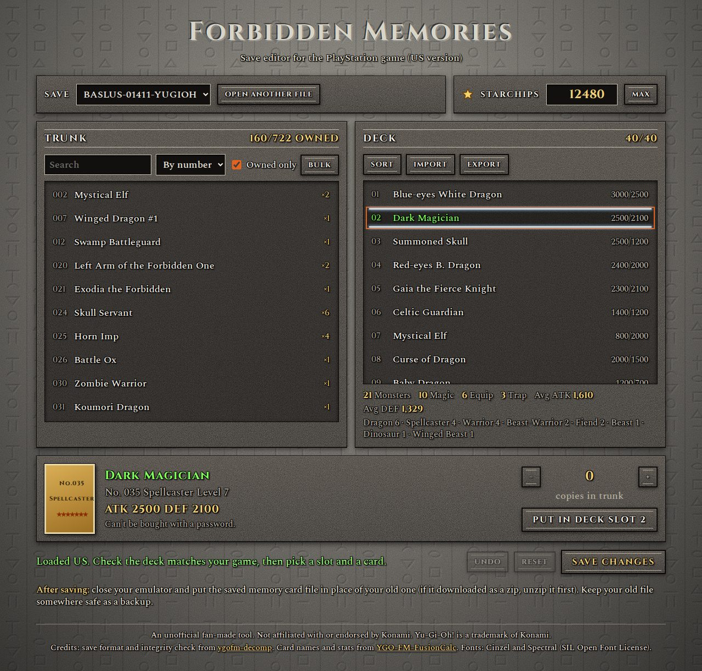
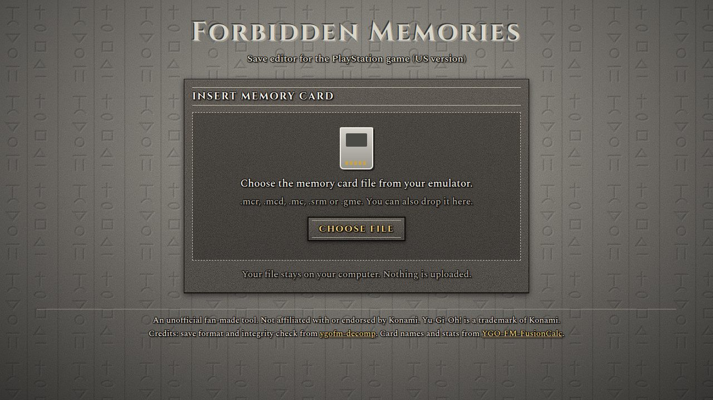
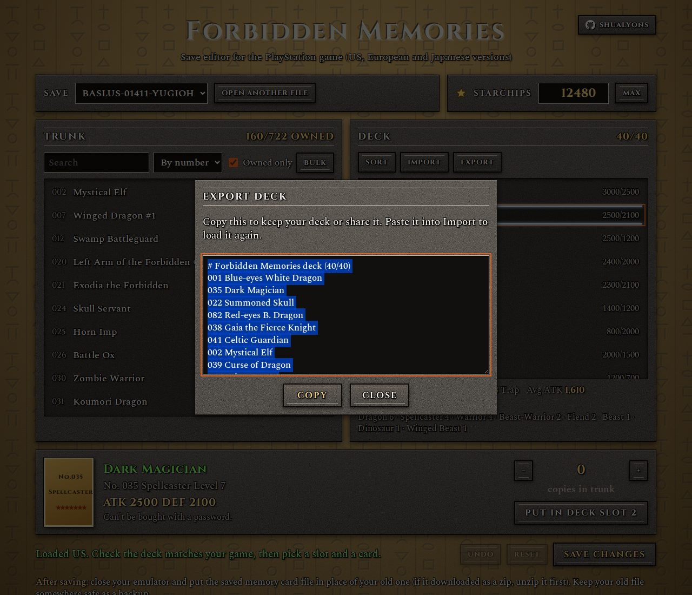
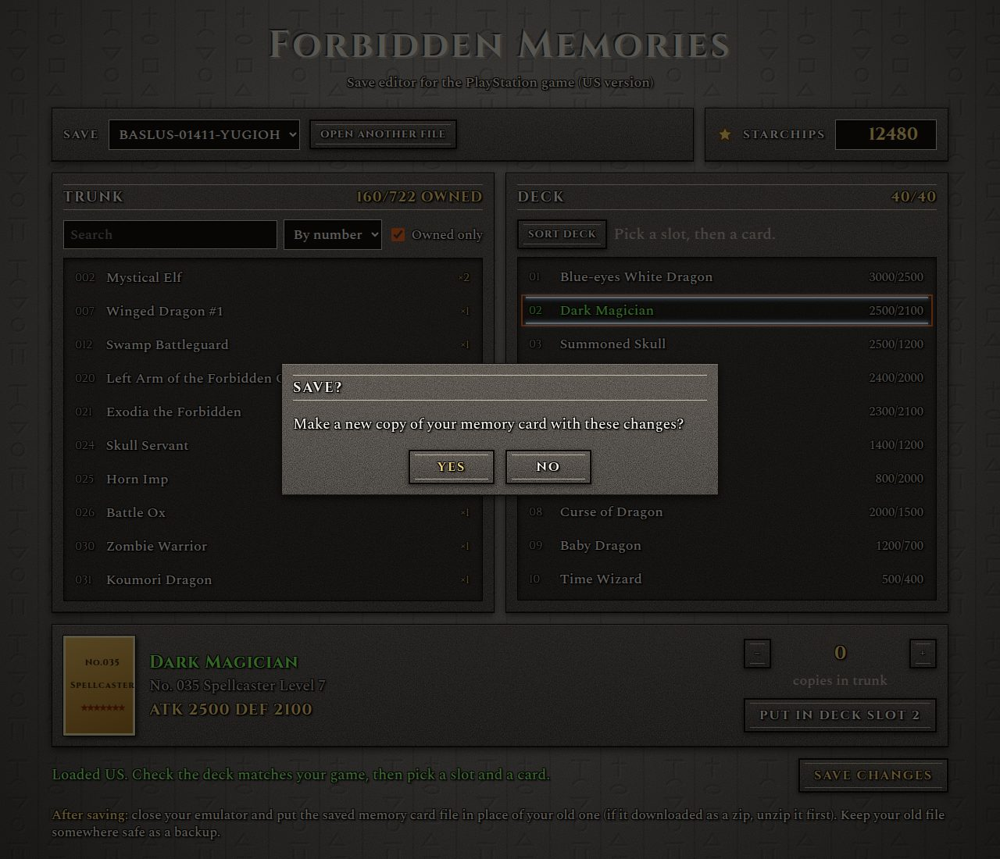
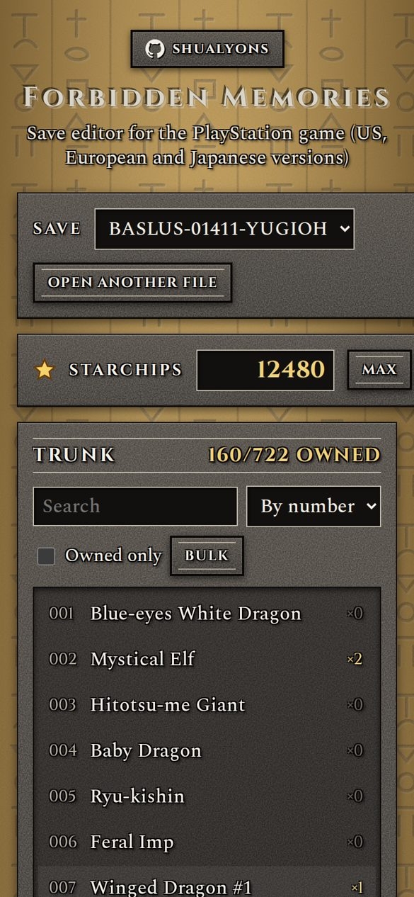

# Forbidden Memories Save Editor

A save editor for **Yu-Gi-Oh! Forbidden Memories** (PlayStation, US, European and Japanese versions) that runs entirely in your web browser. Change your deck, the cards in your trunk, and your starchips, then load the edited save in your emulator.

**Use it here:** https://shualyons.github.io/fm-save-editor/

Nothing to install, and your save never leaves your computer.

## Features

- **Deck editing:** put any of the game's 722 cards into any of your 40 deck slots.
- **Trunk editing:** set how many copies of each card you own.
- **Starchips:** set your total, or max it out with one click.
- **Card info:** ATK/DEF, type and level, plus each card's password and starchip cost (and whether you can afford it).
- **Deck stats:** monster, magic and trap counts, average ATK and DEF, and a breakdown by type.
- **Deck import and export:** copy your deck as text to keep or share it, and paste one back in. Card numbers, names and "3x Card Name" all work.
- **Undo and reset:** undo any change (Ctrl+Z), or put everything back to how it was when you opened the save.
- **Bulk actions:** give yourself 1 or 3 of every card in one go.
- **Card search and sorting** by name, number, ATK, DEF or type, with an "owned only" filter.
- **Deck check:** warns about anything the game would refuse, such as empty slots or more than 3 copies of a card (or more than 1 of each Exodia piece).
- **Styled after the game's own menus.**

## Screenshots

| Opening a memory card | Exporting a deck | Confirming a save | On a phone |
| --- | --- | --- | --- |
|  |  |  |  |

## How to use

1. **Close your emulator** so it isn't holding the memory card file.
2. Open the editor and click **Choose file**, then pick your memory card file.
3. Click a slot in your deck, then double-click a card in the trunk to put it there.
4. Click **Save changes**. Your edited memory card file downloads with the same name.
5. Replace your old memory card file with the new one. **Keep a copy of the old one as a backup.**
6. Start the game and use the game's **Load** option. Don't load an emulator save state: states contain the old data from before your edits.

### Supported files

| Format | Used by |
| --- | --- |
| `.mcd` | DuckStation (tested) |
| `.mcr` | ePSXe, Mednafen and others |
| `.srm` | RetroArch |
| `.gme` | DexDrive |

Most raw 128 KB PS1 memory card images should work.

## Use it offline

The whole editor is a single file, so it works without an internet connection:

1. In this repository, click **index.html**, then the **Download raw file** button (the downward arrow near the top right of the file view).
2. Save it somewhere easy to find, such as your desktop. You can rename it, for example to `fm-save-editor.html`.
3. Double-click it to open it in your browser. Everything works the same as the website: opening, editing and saving.

The fonts are built into the file, so it looks the same offline too. Download the file again whenever there's an update.

## Is it safe?

- **Your file stays on your computer.** Everything happens in your browser. Nothing is uploaded, and the page doesn't load anything from other websites.
- **The game checks its own saves.** Forbidden Memories protects its save data with a checksum and refuses saves that don't match. The editor recalculates this exactly as the game does, so edited saves load normally. This has been tested in DuckStation.
- **It won't touch saves it doesn't recognise.** If a save doesn't pass the game's check when you open it, the editor refuses to edit it.

Even so, always keep a backup of your original memory card file.

## Limitations

- **Supported versions:** US (SLUS-01411) and European (SLES-03947 to SLES-03951). Tested in DuckStation with the US disc and the European SLES-03947 and SLES-03948 discs; the other European discs should work the same way. Each European disc only sees saves made with its own disc.
- **Japanese version:** Yu-Gi-Oh! Shin Duel Monsters (SLPM-86396, SLPM-86398 and SLPM-86573). Tested in DuckStation with SLPM-86398. Card names are shown in English, but the card numbers match the game.
- Card names are shown in English.
- The editor doesn't change Library progress, campaign progress or duelist records.

## How it works

The game keeps its save data in a 0x680-byte block that it writes to the memory card twice, as a main copy and a backup. Inside the block:

| Offset | Size | Contents |
| --- | --- | --- |
| `+0x000` | 80 bytes | Deck: 40 card IDs (16-bit) |
| `+0x050` | 722 bytes | Trunk: number of copies of each card |
| `+0x5E0` | 4 bytes | Starchips |

Three regions of the block are sealed with a CRC-16 and a run of pseudo-random words generated from it. When it loads a save, the game recomputes the seal and treats the save as corrupt if anything differs. The editor reseals both copies every time it saves.

## Credits

- Save format and integrity check: [ygofm-decomp](https://github.com/MaChInEgUn3/ygofm-decomp), a decompilation of the game.
- Card names and stats: [YGO-FM-FusionCalc](https://github.com/Solumin/YGO-FM-FusionCalc).
- Fonts: [Cinzel](https://github.com/NDISCOVER/Cinzel) and [Spectral](https://github.com/productiontype/Spectral), both under the SIL Open Font License 1.1.

## Disclaimer

This is an unofficial fan-made tool. It is not affiliated with or endorsed by Konami. Yu-Gi-Oh! is a trademark of Konami. No game code, artwork or other assets are included.

## License

The editor's code is released under the [MIT License](LICENSE). The license covers this project's code only, not the card data or anything belonging to Konami.

## AI disclosure

This project was built with AI assistance. I decided what to build, pointed it to the research it used, chose the design, and tested the editor on real saves in DuckStation before releasing it.
